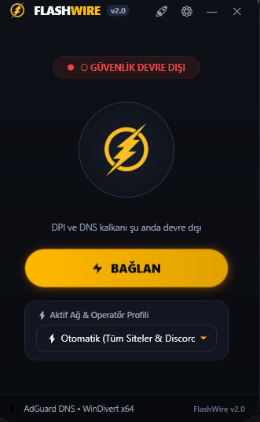

<div align="center">

# ⚡ FlashWire v2.0 (Windows)
### Yüksek Hızlı DPI (Derin Paket İnceleme) ve DNS Engeli Aşma Kalkanı

<p align="center">
  
</p>

[-blue.svg?style=for-the-badge&logo=windows)](https://github.com/beratcemzengin/flashwire)
[](https://github.com/beratcemzengin/flashwire/releases)
[](LICENSE)
[-success.svg?style=for-the-badge)](#-flashwire-nedir-ve-neler-yapabilir)

**FlashWire**, Türkiye'deki internet servis sağlayıcılarının (Turkcell, Vodafone, Türk Telekom, TurkNet, Kablonet) uyguladığı DPI (Deep Packet Inspection) ve DNS filtrelerini yerel paket desenkronizasyonu tekniğiyle aşan, **sıfır ping ve hız kaybıyla** çalışan bağımsız (portable) bir Windows masaüstü aracıdır.

---

</div>

## 📦 İndir (Release)

Kurulum gerektirmez; dosyayı indirip doğrudan çalıştırabilirsiniz.

| Dosya Adı | Açıklama | Boyut | Bağlantı |
| :--- | :--- | :---: | :---: |
| **`FlashWire-v2.0-Windows-x64.zip`** | **Önerilen Paket** (FlashWire.exe + Hızlı Başlatıcı + Kullanım Kılavuzu) | ~2.0 MB | [⬇️ İndir (.ZIP)](release/FlashWire-v2.0-Windows-x64.zip) |
| **`FlashWire.exe`** | Tek Dosya Bağımsız Çalıştırılabilir Uygulama (Portable) | ~2.0 MB | [⬇️ İndir (.EXE)](release/FlashWire.exe) |

> [!NOTE]  
> Sürüm notları ve SHA-256 doğrulama kodları için [RELEASE_NOTES.md](RELEASE_NOTES.md) dosyasını inceleyebilirsiniz.

---

## 💡 FlashWire Nedir ve Neler Yapabilir?

Geleneksel VPN'ler tüm internet trafiğinizi yurt dışındaki uzak ve yavaş sunuculara yönlendirir; bu durum ping değerlerinizi 100-200 ms artırır ve internet hızınızı düşürür.

**FlashWire ise bir VPN DEĞİLDİR:**
- **Sıfır Ping ve Hız Kaybı:** Trafiğinizi harici bir sunucuya göndermez. Kendi bilgisayarınızda kernel seviyesinde (WinDivert sürücüsüyle) paket başlıklarını DPI sistemlerinin tanıyamayacağı şekilde anlık olarak desenkronize eder.
- **Discord & Roblox Erişimi:** Discord masaüstü uygulamasını, ses kanallarını, ekran paylaşımlarını ve Roblox'u gecikmesiz açar.
- **Tüm Engelli Servisler:** Wattpad, Ekşi Sözlük, Instagram ve sansürlenen diğer siteleri pürüzsüz açar.
- **AdGuard Güvenli DNS:** İSS tarafındaki DNS zehirleme (DNS hijacking) girişimlerini önler ve istenmeyen reklamları yerel olarak engeller.
- **Tamamen Taşınabilir (Portable):** Sistem dosyalarına veya Registry'ye kalıntı bırakmaz. Gerekli tüm sürücüler exe'nin içinde gömülüdür.

---

## 🎛️ Arayüz ve Buton Rehberi

Aşağıdaki rehber, FlashWire penceresindeki tüm butonların ve fonksiyonların ne işe yaradığını detaylandırmaktadır:

<div align="center">
  
</div>

### 1. Üst Başlık Çubuğu (Header Bar)
*Pencereyi ekranın istediğiniz yerine taşımak için üst başlık çubuğuna tıklayıp sürükleyebilirsiniz.*

- **⚡ FlashWire Logosu & `v2.0` Rozeti:** Uygulamanın güncel sürüm durumunu simgeler.
- **🚀 Roket Butonu (Canlı Ağ & Site Teşhisi):**
  - Tıklandığında pencerenin alt kısmında **Canlı Teşhis Çekmecesi** açılır.
  - Tek tıkla **Discord, Roblox, Wattpad, Ekşi Sözlük, Instagram ve YouTube** sunucularına test istekleri gönderir.
  - Sitelerin açık olup olmadığını ve gerçek tepki sürelerini (örn: `✔ 42 ms` veya `✖ Engelli`) listeler.
- **⚙ Çark Butonu (Operatör Ayarları):**
  - Aktif Ağ ve Operatör Profil kartını gizleyip açmanızı sağlar.
- **— Çizgi Butonu (Küçült):**
  - Pencereyi Windows görev çubuğuna ve sistem tepsisine (Tray) simge durumuna küçültür.
- **✕ Kapat Butonu:**
  - Açık olan DPI korumasını güvenli şekilde durdurur, DNS ayarlarınızı otomatik olarak orijinal haline geri döndürür ve uygulamayı kapatır.

---

### 2. Durum Rozeti & Halo Ekranı
- **`● ○ GÜVENLİK DEVRE DIŞI` / `● FLASHWIRE KORUMASI AKTİF` Rozeti:**
  - Kırmızı olduğunda korumanın kapalı olduğunu; yeşil/altın parladığında tüm paketlerin filtrelenip engellerin aşıldığını bildirir.
- **Merkez Halo Orb (Çift Katmanlı Işıma):**
  - Cyberpunk Altın parıltı efektiyle kalkanın devrede olup olmadığını görsel olarak yansıtır.
- **Açıklama Metni:**
  - `"DPI ve DNS kalkanı şu anda devre dışı"` ya da `"Discord, Roblox ve tüm servisler açık"` şeklinde kullanıcıyı bilgilendirir.

---

### 3. Eylem Butonu (Ana Bağlantı Tuşu)
- **⚡ BAĞLAN (Altın Buton):**
  - Tek bir tıklama ile WinDivert paket filtresini ve AdGuard DNS kalkanını devreye sokar.
- **✕ BAĞLANTIYI KES (Kırmızı Buton):**
  - Bağlantı aktifleştiğinde buton kırmızı renge bürünür. Tıklandığında anında korumayı durdurur ve DNS adreslerinizi sıfırlar.

---

### 4. Operatör & Profil Seçici
Kullandığınız internet sağlayıcısının uyguladığı sansür yöntemine en uygun bypass profilini seçebilirsiniz:

| Profil | Desteklenen Sağlayıcı | Açıklama |
| :--- | :--- | :--- |
| **⚡ Otomatik** | *Tüm Ağlar & Genel* | Discord ve tüm siteler için en kararlı genel koruma modudur *(Varsayılan)*. |
| **🔴 Turkcell** | Turkcell & Superonline | Superonline fiber ve mobil ağlarındaki özel DPI filtrelerini aşmak için optimize edilmiştir. |
| **🟣 Vodafone** | Vodafone Fiber & Redbox | Vodafone şebekesindeki TCP TTL ve paket bölme (multisplit) kurallarını uygular. |
| **🔵 Türk Telekom** | TTNet & Mobil | Türk Telekom omurgasındaki SNI engellemelerini desync teknikleriyle aşar. |
| **🟡 TurkNet** | GigaFiber & VDSL | TurkNet hatları için minimum gecikmeli hızlı bypass modudur. |
| **🟢 Türksat Kablonet**| Uydunet / Kablonet | Kablonet filtrelerine özel paket sırası değiştirme modudur. |
| **🌐 Evrensel Mod** | Tüm Şebekeler | Standart GoodbyeDPI -5 moduyla genel koruma sağlar. |

---

### 5. Alt Bilgi Çubuğu (Footer)
- **🛡️ AdGuard DNS • WinDivert x64:** Aktif koruma motorunun ve kullanılan güvenli DNS katmanının bilgisini canlı olarak gösterir.
- **FlashWire v2.0:** Yapı ve sürüm bilgisi.

---

## 🚀 Adım Adım Kullanım Kılavuzu

1. **İndirin:** [release/FlashWire-v2.0-Windows-x64.zip](release/FlashWire-v2.0-Windows-x64.zip) arşivini indirin ve bir klasöre çıkartın.
2. **Çalıştırın:** `FlashWire.exe` dosyasına çift tıklayın veya `Baslat.bat` dosyasını çalıştırın.
3. **Yönetici İznini Onaylayın:**
   > [!IMPORTANT]  
   > FlashWire, ağ trafiğindeki sansürlü paketleri yerel sürücü seviyesinde çözmek için `WinDivert` filtre sürücüsünü kullanır. Bu nedenle açılışta çıkan Windows Yönetici İzni (UAC) uyarısına **"Evet"** demeniz gerekmektedir.
4. **Bağlanın:** Sarı parlayan **`⚡ BAĞLAN`** butonuna basın.
5. **Keyfini Çıkarın:** Discord'a girin, Roblox'u başlatın veya dilediğiniz internet sitesinde özgürce gezinin!

---

## 🛠️ Kaynak Koddan Derleme (Build from Source)

Projeyi kendi bilgisayarınızda derlemek isterseniz:

### Gereksinimler
- Windows 10 / 11 (x64)
- .NET Framework 4.8 veya üzeri
- MSBuild veya Visual Studio 2022

### Tek Tıkla Derleme
Depo kök dizinindeki `Derle.bat` dosyasını çalıştırmanız yeterlidir:
```cmd
Derle.bat
```
Derlenen çıktı dosyası doğrudan `bin\Release\FlashWire.exe` konumunda oluşturulacaktır.

### Release Paketi Hazırlama
Tüm zip ve exe dosyalarını tek komutla oluşturmak için:
```cmd
Paketle.bat
```

---

## ❓ Sıkça Sorulan Sorular (SSS)

**S: FlashWire oyunlarda pingimi artırır mı?**  
**C:** Kesinlikle hayır. FlashWire bir VPN değildir. Trafiğiniz yurt dışı sunuculara yönlendirilmez; internet servis sağlayıcınızın sağladığı orijinal hız ve ping değerleri korunur.

**S: Discord'da ses kanallarına girebilir miyim?**  
**C:** Evet, Discord ses ve görüntü protokolleri (WebRTC/UDP) için gerekli kurallar profillerin içerisine entegre edilmiştir.

**S: Programı kapattığımda internet ayarlarım bozulur mu?**  
**C:** Hayır. FlashWire kapatıldığında uyguladığı geçici AdGuard DNS adreslerini otomatik temizler ve ağ adaptörünüzü varsayılan ayarlarına geri döndürür.

---

## ⚖️ Lisans

Bu proje **MIT Lisansı** altında özgür bir açık kaynak yazılım olarak paylaşılmaktadır. Detaylar için [LICENSE](LICENSE) dosyasına göz atabilirsiniz.

---

<div align="center">
  <sub>Geliştirici: <b>beratcemzengin</b> • ⚡ FlashWire v2.0</sub>
</div>
